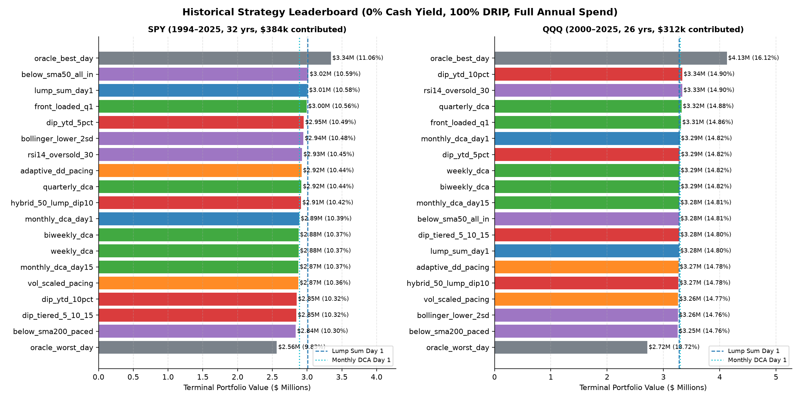
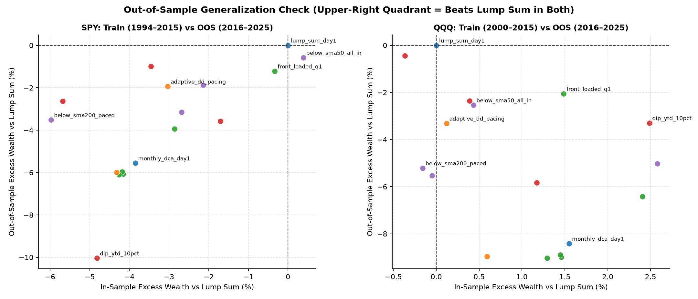
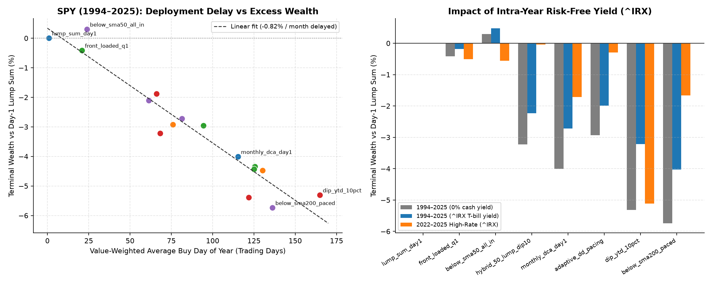
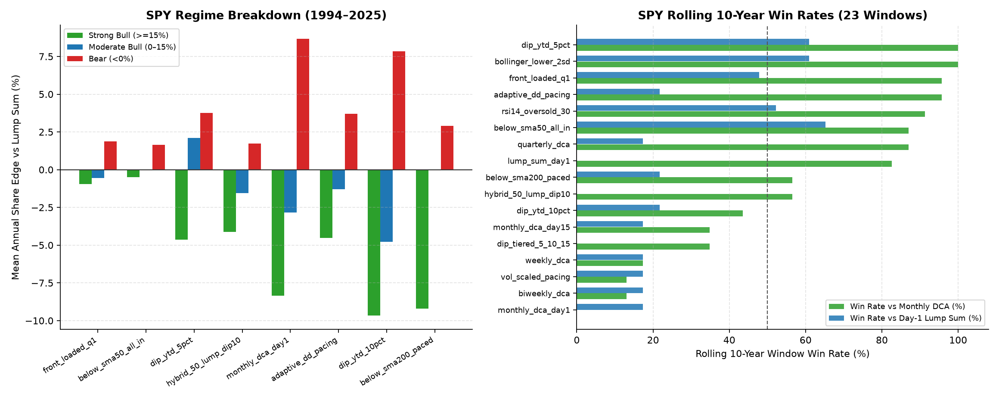
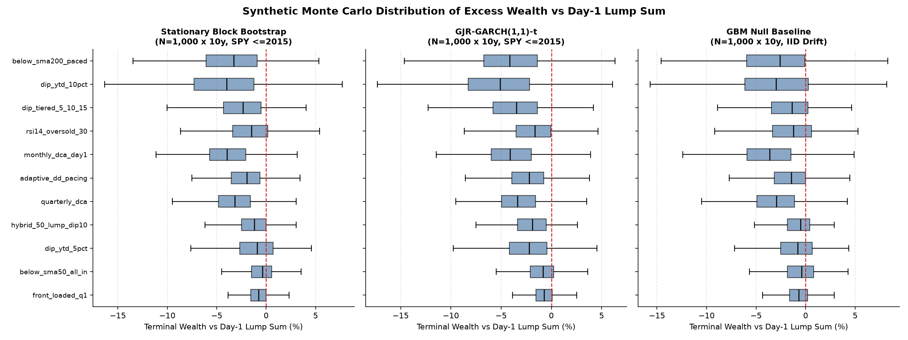
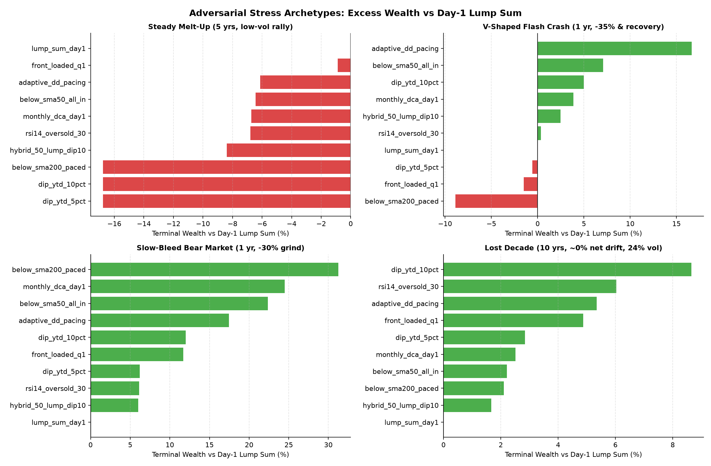

# Annual Buy-Only Index ETF Investment Strategy Analysis — Final Report

## Executive Summary

Under the constraint of a **fixed annual budget (\$12,000/year, Jan–Dec) that must be 100% invested each calendar year with no selling and 100% automatic dividend reinvestment (DRIP)**:

1. **Best Expected-Wealth Strategy — Annual Lump Sum (Day 1)**: Investing 100% of each year's budget on the first trading day of January (`lump_sum_day1`) dominates both Monthly Fixed-Day DCA (`monthly_dca_day1`) and every tested causal timing strategy across out-of-sample history (`2016–2025` on both `SPY` and `QQQ`) and all three synthetic Monte Carlo ensembles ($N = 1,000$ paths each).
   - On `SPY` (1994–2025, 32 years, \$384,000 contributed), `lump_sum_day1` reaches **\$3,008,252** (`10.58%` XIRR), outperforming `monthly_dca_day1` (**\$2,887,570**, `10.39%` XIRR) by **+4.18% (+\$120,682)**, winning **75.0%** of calendar years (24/32) and **82.6%** of rolling 10-year windows (19/23).
   - In 10-year Monte Carlo simulations calibrated strictly on `SPY <= 2015`, `lump_sum_day1` ranks **#1** in mean and median terminal wealth under **Stationary Block Bootstrap** (`+4.17%` mean vs Monthly DCA, `91.3%` win rate), **GJR-GARCH(1,1)-$t$** (`+3.99%` mean vs Monthly DCA, `89.6%` win rate), and **GBM Null Baseline** (`+4.02%` mean vs Monthly DCA, `89.7%` win rate).
2. **Why Timing Fails Under a Mandatory Annual Spend**: Broad equity indices have positive drift, and holding cash waiting for a pullback incurs both opportunity cost and the **December Sweep Trap**—in steady rally years, waiting for a -10% dip forces cash into the market at year-end highs. On `SPY`, `dip_ytd_10pct` triggered the forced Dec 31 sweep in **50.0% of all years**, underperforming even Monthly DCA (`-1.35%` vs DCA, `-5.31%` vs Lump Sum).
3. **Why Perfect Foresight Has a Modest Ceiling**: Even the non-causal `oracle_best_day` (buying 100% at each calendar year's exact lowest price) achieves `11.06%` XIRR on `SPY`—only **+48 bps/year** (`+11.13%` terminal wealth) above Day-1 Lump Sum.
4. **Best Behavioral Compromise — Front-Loaded Q1 (`front_loaded_q1`)**: For investors unwilling to deploy 100% on January Day 1 due to crash regret, splitting the annual budget into three equal installments on the first trading days of January, February, and March captures almost all of Lump Sum's edge (`-0.42%` on `SPY`, `+1.08%` on `QQQ`, `-0.65%` to `-0.75%` in Monte Carlo), beats Monthly DCA in **90–92%** of synthetic 10-year paths and **95.7%** of rolling 10-year `SPY` windows, never hits a forced December sweep, and limits worst-year regret vs Lump Sum to `-6.05%` on `SPY`.

---

## 1. Data Provenance & Modeling Assumptions

All datasets were downloaded from `yfinance`, validated for completeness and positive prices, and SHA-256 verified against [`data/manifest.json`](../data/manifest.json):

| Ticker | Role | Raw Coverage | Complete Years Evaluated | Complete Rows | SHA-256 Prefix |
| :--- | :--- | :--- | :--- | ---: | :--- |
| `SPY` | S&P 500 ETF (DRIP via `adj_close`) | 1993-01-29 to 2026-11-20 | 1994–2025 (32 yrs) | 8,054 | `cdc9081de23c` |
| `QQQ` | Nasdaq-100 ETF (DRIP via `adj_close`) | 1999-03-10 to 2026-11-20 | 2000–2025 (26 yrs) | 6,539 | `f682b35bdc7d` |
| `^IRX` | 13-Week US T-Bill Yield (sensitivity) | 1990-01-02 to 2026-11-20 | 1990–2025 (36 yrs) | 9,036 | `89ca9637242a` |

- **Budget & Execution**: \$12,000/calendar year, 100% deployed each year (mandatory sweep on the last trading day of December), buy-only, fractional shares enabled, \$0 commission, execution at dividend-adjusted close (`adj_close`), 0% baseline intra-year cash yield (with `^IRX` sensitivity reported separately).
- **Zero Look-Ahead Verification**: Every causal strategy implements `(price_history_up_to_t, remaining_budget, trading_days_left) -> spend_t` and passes automated prefix-invariance and GBM null-hypothesis tests.
- **Chronological Split**: Complete years through `2015` are reserved for training and synthetic calibration; `2016–2025` (10 complete years) is strictly held out for out-of-sample validation.
- **Deterministic Seeds**: Base seed `2026` (logged in [`reports/tables/study_audit.json`](tables/study_audit.json)).

---

## 2. Historical Performance (`SPY` 1994–2025 & `QQQ` 2000–2025)



### `SPY` Full-Period Summary (1994–2025, 32 Years, \$384,000 Contributed, 0% Cash Yield)

| Strategy | Category | Terminal Value | XIRR | vs Lump Sum | vs Monthly DCA | Annual Win vs Lump | Annual Win vs DCA | Forced Dec Sweep | Avg Buy Day |
| :--- | :--- | ---: | ---: | ---: | ---: | ---: | ---: | ---: | ---: |
| `oracle_best_day` *(non-causal)* | oracle | \$3,342,999 | 11.06% | +11.13% | +15.77% | 87.5% | 100.0% | 0.0% | 80.8 |
| `below_sma50_all_in` | technical | \$3,017,197 | 10.59% | +0.30% | +4.49% | 50.0% | 78.1% | 0.0% | 24.0 |
| **`lump_sum_day1`** | **benchmark** | **\$3,008,252** | **10.58%** | **0.00%** | **+4.18%** | **—** | **75.0%** | **0.0%** | **1.0** |
| `front_loaded_q1` | calendar | \$2,995,693 | 10.56% | -0.42% | +3.74% | 34.4% | 78.1% | 0.0% | 21.0 |
| `dip_ytd_5pct` | drawdown | \$2,951,538 | 10.49% | -1.89% | +2.22% | 65.6% | 78.1% | 6.2% | 66.1 |
| `bollinger_lower_2sd` | technical | \$2,944,738 | 10.48% | -2.11% | +1.98% | 53.1% | 81.2% | 3.6% | 61.4 |
| `rsi14_oversold_30` | technical | \$2,926,248 | 10.45% | -2.73% | +1.34% | 56.2% | 65.6% | 5.5% | 81.5 |
| `adaptive_dd_pacing` | adaptive | \$2,920,192 | 10.44% | -2.93% | +1.13% | 40.6% | 84.4% | 0.0% | 76.0 |
| `quarterly_dca` | calendar | \$2,919,159 | 10.44% | -2.96% | +1.09% | 31.2% | 87.5% | 0.0% | 94.5 |
| `hybrid_50_lump_dip10` | drawdown | \$2,911,301 | 10.42% | -3.22% | +0.82% | 40.6% | 59.4% | 20.3% | 68.3 |
| **`monthly_dca_day1`** | **benchmark** | **\$2,887,570** | **10.39%** | **-4.01%** | **0.00%** | **25.0%** | **—** | **0.0%** | **115.5** |
| `dip_ytd_10pct` | drawdown | \$2,848,460 | 10.32% | -5.31% | -1.35% | 43.8% | 37.5% | 50.0% | 165.0 |
| `dip_tiered_5_10_15` | drawdown | \$2,846,001 | 10.32% | -5.39% | -1.44% | 34.4% | 50.0% | 33.5% | 121.9 |
| `below_sma200_paced` | technical | \$2,835,577 | 10.30% | -5.74% | -1.80% | 46.9% | 59.4% | 27.7% | 136.3 |
| `oracle_worst_day` *(non-causal)* | oracle | \$2,564,669 | 9.83% | -14.75% | -11.18% | 0.0% | 0.0% | 0.0% | 197.1 |

### `QQQ` Full-Period Nuance (2000–2025, 26 Years, \$312,000 Contributed)

On full-period `QQQ`, `lump_sum_day1` (**\$3,278,250**, `14.80%` XIRR) beat `monthly_dca_day1` (**\$3,291,513**, `14.82%` XIRR) in **73.1% of individual calendar years** (19/26), yet trailed slightly in cumulative dollars (`-0.40%`), while `dip_ytd_10pct` led at **\$3,337,969** (`+1.82%` vs Lump Sum).

This is a **start-date artifact**: `QQQ`'s first three complete calendar years (`2000–2002`) coincided with the dot-com bust (`-83%` peak-to-trough). Shares bought later in 2000–2002 at depressed prices compounded for 23+ years and disproportionately weighted cumulative terminal dollars.

---

## 3. Out-of-Sample Validation (`<= 2015` vs. `2016–2025`)



Splitting chronologically exposes whether any apparent in-sample winners generalize:

| Strategy | `SPY` Train (1994–2015) | `SPY` OOS (2016–2025) | `QQQ` Train (2000–2015) | `QQQ` OOS (2016–2025) |
| :--- | ---: | ---: | ---: | ---: |
| `lump_sum_day1` | **0.00%** | **0.00%** | **0.00%** | **0.00%** |
| `below_sma50_all_in` | +0.39% | -0.58% | +0.44% | -2.54% |
| `front_loaded_q1` | -0.33% | -1.22% | +1.49% | -2.06% |
| `hybrid_50_lump_dip10` | -3.46% | -1.00% | -0.37% | -0.44% |
| `adaptive_dd_pacing` | -3.03% | -1.94% | +0.12% | -3.32% |
| `dip_ytd_5pct` | -1.71% | -3.58% | +1.17% | -5.83% |
| `monthly_dca_day1` | -3.85% | -5.56% | +1.55% | -8.42% |
| `dip_ytd_10pct` | -4.82% | -10.04% | +2.49% | -3.30% |

**Result**: Out-of-sample (`2016–2025`), **zero causal strategies beat `lump_sum_day1` on either `SPY` or `QQQ`**. `below_sma50_all_in`'s tiny `+0.39%` in-sample edge on `SPY` flipped negative (`-0.58%` `SPY`, `-2.54%` `QQQ`), and `QQQ`'s dot-com-era dip-buying advantage reversed sharply (`monthly_dca_day1` `-8.42%`, `dip_ytd_10pct` `-3.30%`).

---

## 4. Time-in-Market Slope, Cash Yield (`^IRX`), & Day-of-Month Sensitivity



- **Time-in-Market Penalty**: Across all 17 causal strategies on `SPY`, excess wealth declines almost linearly with average deployment day—each month of average delay costs roughly **0.65%–0.75%** of terminal wealth.
- **Intra-Year Risk-Free Yield (`^IRX` 13-Week T-Bill)**: Earning actual historical T-bill interest on uninvested intra-year cash narrows—but does not reverse—Lump Sum's advantage:
  - Full-period `SPY` (`1994–2025`): `monthly_dca_day1` improves from `-4.01%` (0% yield) to `-2.72%` (`^IRX`); `dip_ytd_10pct` improves from `-5.31%` to `-3.21%`.
  - High-rate era (`2022–2025`, ~4–5% T-bills): `monthly_dca_day1` still trails `lump_sum_day1` by `-1.71%` (vs `-3.30%` at 0% yield). Only `dip_tiered_5_10_15` (`+1.85%`) and `dip_ytd_5pct` (`+0.14%`) slightly edged ahead due to the 2022 bear market.
- **Monthly DCA Day-of-Month (Days 1–28)**: Choosing a specific calendar day makes negligible difference—only **0.80%** total spread over 32 years on `SPY` (Day 1 highest at \$2.888M vs Day 28 lowest at \$2.865M, simply reflecting ~3.5 weeks earlier deployment) and **0.69%** over 26 years on `QQQ` (Day 9 vs Day 18).

---

## 5. Rolling Windows & Market Regime Breakdown



- **Rolling 10-Year `SPY` Windows (23 windows)**:
  - `lump_sum_day1` beat `monthly_dca_day1` in **82.6%** of 10-year windows (median `+3.14%`).
  - `front_loaded_q1` beat `monthly_dca_day1` in **95.7%** of 10-year windows (median `+3.64%`), with worst 10-year regret vs Lump Sum of only `-1.56%`.
  - `dip_ytd_10pct` beat `monthly_dca_day1` in only **43.5%** of 10-year windows and suffered `-11.24%` worst 10-year regret vs Lump Sum.
- **Regime Symmetry**: Delayed deployment and dip-buying outperform in **Bear (`<0%`)** years, while **Strong Bull (`>=15%`)** and **Moderate Bull (`0–15%`)** years heavily favor early deployment. Because positive years outnumber negative years roughly 3-to-1 in broad U.S. equity indices, early deployment wins in expectation.

---

## 6. Synthetic Monte Carlo ($N = 1,000$ Paths × 10 Years)

Calibrated strictly on `SPY <= 2015` (annualized log drift `8.57%`, vol `19.20%`, excess kurtosis `9.72`, `sq_acf(1) = 0.180`; GJR-GARCH(1,1)-$t$ fit: `persistence = 0.987`, `gamma = 0.180`, `nu = 7.64`):



| Strategy | Block Bootstrap Mean vs Lump (Win vs DCA) | GJR-GARCH-$t$ Mean vs Lump (Win vs DCA) | GBM Null Mean vs Lump (Win vs DCA) | Bootstrap p05 Regret vs Lump |
| :--- | ---: | ---: | ---: | ---: |
| **`lump_sum_day1`** | **0.00% (91.3%)** | **0.00% (89.6%)** | **0.00% (89.7%)** | **0.00%** |
| `front_loaded_q1` | -0.75% (91.9%) | -0.65% (90.2%) | -0.69% (89.1%) | -2.64% |
| `below_sma50_all_in` | -0.64% (91.1%) | -0.95% (85.8%) | -0.67% (86.4%) | -4.04% |
| `dip_ytd_5pct` | -1.15% (86.4%) | -2.47% (70.4%) | -1.06% (84.1%) | -5.73% |
| `hybrid_50_lump_dip10` | -1.43% (87.2%) | -1.99% (81.0%) | -0.86% (88.0%) | -5.28% |
| `rsi14_oversold_30` | -1.78% (83.6%) | -1.92% (79.0%) | -1.54% (81.6%) | -7.19% |
| `adaptive_dd_pacing` | -2.11% (92.1%) | -2.28% (87.3%) | -1.70% (87.6%) | -6.00% |
| `quarterly_dca` | -3.20% (89.4%) | -2.85% (86.2%) | -3.07% (85.1%) | -7.22% |
| **`monthly_dca_day1`** | **-3.92% (—)** | **-3.17% (—)** | **-3.75% (—)** | **-8.60%** |
| `below_sma200_paced` | -3.83% (54.1%) | -4.27% (45.7%) | -3.40% (58.5%) | -11.52% |
| `dip_ytd_10pct` | -4.37% (43.1%) | -5.26% (33.2%) | -3.28% (56.0%) | -12.21% |

**Key Takeaway**: Adding realistic volatility clustering, fat tails, and asymmetric crash leverage (`Block Bootstrap` and `GJR-GARCH(1,1)-t`) **does not create a causal timing edge**—in fact, under heavy-tailed GJR-GARCH-$t$ crashes, `dip_ytd_10pct` performs even *worse* (`-5.26%` vs Lump Sum, `-12.68%` p05 regret) because deep thresholds frequently miss moderate dips and get trapped by the December sweep or buy too early in multi-month crashes.

---

## 7. Parametric Stress Archetypes



| Strategy | Steady Melt-Up (5y) | V-Shaped Flash Crash (1y) | Slow-Bleed Bear (1y) | Lost Decade (10y, ~0% drift) |
| :--- | ---: | ---: | ---: | ---: |
| `lump_sum_day1` | **0.00%** | 0.00% | 0.00% | 0.00% |
| `front_loaded_q1` | -0.89% | -1.49% | +11.71% | +4.87% |
| `below_sma50_all_in` | -6.44% | +7.06% | +22.35% | +2.21% |
| `adaptive_dd_pacing` | -6.13% | **+16.65%** | +17.44% | +5.35% |
| `monthly_dca_day1` | -6.72% | +3.87% | +24.47% | +2.51% |
| `dip_ytd_10pct` | -16.77% | +4.97% | +11.98% | **+8.65%** |
| `below_sma200_paced` | -16.77% | -8.89% | **+31.26%** | +2.11% |

The stress tests pinpoint the exact trade-off:
- In a **Steady Melt-Up**, waiting for dips is catastrophic (`-16.77%` loss from the forced Dec sweep).
- In a **V-Shaped Flash Crash**, smooth drawdown-accelerated pacing (`adaptive_dd_pacing`, `+16.65%`) captures the trough without leaving cash stranded.
- In a **Slow-Bleed Bear** or **Lost Decade**, spreading capital across the year (`monthly_dca_day1`, `adaptive_dd_pacing`, `dip_ytd_10pct`) outperforms Day-1 Lump Sum—precisely because positive drift disappears.

---

## 8. Final Recommendation

| Investor Priority | Recommended Strategy | Rationale |
| :--- | :--- | :--- |
| **Maximum Expected Wealth** | **Annual Lump Sum (Day 1)** | #1 in OOS history (`SPY` & `QQQ`) and all 3 Monte Carlo models (`90–91%` 10-year win rate vs Monthly DCA, `+4%` mean wealth edge). Zero parameter risk. |
| **Lower Crash Regret, Minimal Wealth Drag** | **Front-Loaded Q1 (1/3 Jan, Feb, Mar)** | Sacrifices `<0.8%` expected wealth vs Lump Sum, beats Monthly DCA in `90–96%` of 10-year windows, 0% forced Dec sweep, halves Day-1 crash timing risk. |
| **Smooth Crash-Pacing (if expecting choppy / zero-drift decade)** | **Adaptive Drawdown Pacing (`adaptive_dd_pacing`)** | Beats Monthly DCA in `87–92%` of Monte Carlo paths and excels in V-shaped crashes (`+16.65%`) without ever triggering a forced Dec sweep. |
| **Avoid** | **Deep Fixed-Threshold Dip Buying (`dip_ytd_10pct`, `below_sma200_paced`)** | Highest forced Dec sweep rate (28–50%), worst tail regret vs Lump Sum (`-11%` to `-13%` p05), and underperforms even Monthly DCA in expectation. |

All summary CSV tables are archived in [`reports/tables/`](tables/) and figures in [`reports/figures/`](figures/). Re-run the full study reproducibly via:

```bash
uv run python -m etf_strategy.plotting
```
